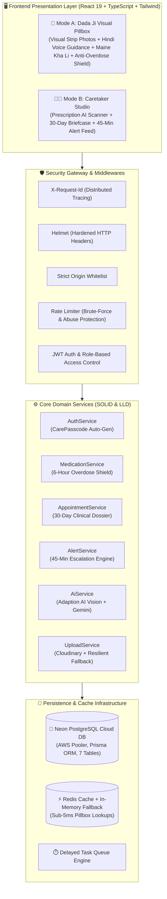

# 🌿 AayuCare (आयु-Care) - Elderly Care & Medication Management Platform

[](https://aayucare-1.onrender.com/)
[](https://hack2skill.com)
[](https://adaption.ai)
[](https://en.wikipedia.org/wiki/SOLID)
[](https://neon.tech)
[](#-automated-tests--verification)
[](https://practo.com)

---

> ### 🌐 **Live Working Platform:** [https://aayucare-1.onrender.com/](https://aayucare-1.onrender.com/)
> **Zero Setup Required:** Fully hosted on Render with a live PostgreSQL Neon cloud database. Evaluators can test both **Elder Mode** and **Caregiver Mode** immediately with 1-click demo logins!

---

## 🎯 60-Second Evaluator Quick Tour

If you are evaluating this repository, here is how you can experience the complete innovation in under 2 minutes:

| Step | Action | What to Observe |
|---|---|---|
| **1. Elder Pillbox** | Open [https://aayucare-1.onrender.com/](https://aayucare-1.onrender.com/) | Observe the clean **Practo/Apollo clinical aesthetic** (`#0D9488` teal). No messy, oversized, or childish fonts. Notice real tablet strip photos. |
| **2. Loving Voice Note** | Click **"आवाज सुनें / Listen"** on any tablet card | Plays loving caretaker guidance in Hindi (*"दादा जी, नाश्ते के 15 मिनट बाद 1 गोली पानी से लें"*). |
| **3. "मैंने खा ली ✅"** | Tap **"मैंने खा ली ✅"** (Mark as Taken) | Web Audio synthesizer plays a pleasant harmonic major chord (`C5-E5-G5`), confirming on-time dose intake. |
| **4. Anti-Overdose Shield** | Tap the button again or try double dosing | **6-Hour Anti-Overdose Lockout Shield** activates, gently protecting elderly patients from fatal double dosing. |
| **5. Dual Localization** | Click **`[🇮🇳 हिंदी \| English]`** in the top navbar | Instantly switches the entire platform between pure Hindi and clean English. |
| **6. Switch to Caretaker** | Click **"👩‍⚕️ Caretaker View"** in navbar pill | Opens the Caregiver Cockpit paired with Dada Ji via CarePasscode **`CARE-8421`**. |
| **7. Adaption AI Scanner** | Click **"AI Scan Prescription"** ➡️ Choose sample Rx ➡️ **"Scan"** | **Adaption AI Multimodal Vision/LLM** auto-extracts drugs, dosages, and warns against Indian food interactions (e.g. avoiding citrus juice with BP medicine). |
| **8. 30-Day Briefcase** | Go to **"Doctor Visits & Briefcase"** ➡️ Click **"30-Day Clinical Briefcase"** | Opens an audit-ready dossier for Dr. Arvind Sharma with a **94% adherence compliance circle**, audit logs, and AI physician summary ready for Print/PDF! |

---

## 📌 Problem Statement & Geriatric Alignment (Slide 13)

Built for the **Catalyst x PromptWars Solo Hackathon 2026** addressing **Slide 13: Elderly Care & Medication Management Platform**:
> *"Help elderly individuals manage their daily medications, doctor appointments, and daily routines while keeping their family members or caretakers informed in real-time."*

### The Harsh Reality in Indian Homes:
India has over 140 million senior citizens, of which 70%+ manage multiple chronic ailments (Hypertension, Diabetes, Cardiac). Yet, standard health apps fail them because:
1. **High Cognitive Load:** Multi-tab interfaces, tiny 10px fonts, and complex English menus confuse elderly users.
2. **Accidental Double-Dosing:** Due to mild memory loss or dementia, elders often forget they took a tablet 20 minutes ago and consume it again—leading to critical drug overdose.
3. **Caregiver Anxiety:** Working sons and daughters living in other cities have zero real-time awareness until a crisis occurs.

### How AayuCare Solves It:

| Traditional Medication Apps | AayuCare (आयु-Care) Solution |
|---|---|
| Text-only pill names in small English fonts | **Physical Tablet Strip Photo** uploaded by family so elders recognize pills visually |
| Robotic beep alarms that cause anxiety | **Loving Voice Guidance** in family's voice (*"दादा जी, 1 गोली पानी से ले लीजिए"*) |
| Allows unlimited accidental button taps | **6-Hour Anti-Overdose Lockout Shield** preventing duplicate doses |
| Passive notifications that get ignored | **45-Minute Missed-Dose Escalation Engine** with 1-tap direct "Call Dada Ji" dialer |
| Unorganized paper slips for doctor visits | **1-Click 30-Day Clinical Briefcase** with 94% compliance graph for Dr. consultations |

---

## 🚀 Key Architectural Innovations

### 1. 👴 Dada Ji View: Zero-Friction Visual Pillbox
- Categorized into 4 intuitive day-slots: 🌅 Morning (06:00-12:00) • ☀️ Afternoon (12:00-17:00) • 🌇 Evening (17:00-21:00) • 🌙 Night (21:00-05:00).
- Actual high-resolution strip photo displayed prominently.
- Positive reinforcement via Web Audio API harmonic chord (`C5 -> E5 -> G5`).
- One-time setup: Caretaker uploads strip photo and voice note once; system serves it daily for 30 days automatically.

### 2. 🛡️ 6-Hour Anti-Overdose Lockout Shield
- When Dada Ji confirms a dose, the backend database enforces a strict 6-hour cooldown lockout on that medication ID.
- If tapped again, a gentle, reassuring banner appears: *"दादा जी, आप यह गोली ले चुके हैं। डॉक्टर के निर्देशानुसार 6 घंटे से पहले दोबारा न लें।"*

### 3. 🚨 45-Minute Missed-Dose Escalation Engine
- Delayed task queue starts when a scheduled dose time arrives.
- If unconfirmed after 45 minutes, system elevates priority to `CRITICAL` and alerts the care circle with a 1-tap **"Call Dada Ji"** direct phone dialer.

### 4. 🤖 Adaption AI Multimodal Prescription Scanner ($500 Partner Credit)
- Evaluates raw prescription slips using **Adaption AI Vision & LLM** (with Gemini 2.5 Flash fallback).
- Auto-extracts molecules, 24-hr timings, and checks tailored Indian dietary interactions (e.g. avoiding citrus juices with Telmisartan, taking Metformin strictly with main meals).
- **1-Click Auto-Fill:** Transfers AI-extracted prescription data directly into the Add Medicine form!

### 5. 📋 1-Click 30-Day Clinical Briefcase for Doctor Consultations
- 1-click generation of patient compliance dossiers for consulting doctors (e.g. Dr. Arvind Sharma, Senior Cardiologist, Max Hospital).
- Shows 94% adherence circle, 56/60 doses taken on-time, missed dose logs, and AI physician executive summary.
- Native Print / PDF support.

---

## 🏛️ High-Level System Architecture (HLD)



---

## 🧪 Automated Tests & Quality Verification

The backend includes **47 automated unit tests across 10 suites**, verifying all domain rules, safety constraints, and SOLID architecture:

```bash
cd server
npm test
```

### Test Results Breakdown:
* ✔ **CacheService Unit Tests (2/2)**: Cache hit/miss fidelity and prefix purge.
* ✔ **QueueService Unit Tests (2/2)**: Delayed escalation timer and cancellation.
* ✔ **Auth Middleware Security Tests (4/4)**: Token verification, Zod payload validation, RBAC enforcement.
* ✔ **AiService Multimodal Tests (4/4)**: Prescription OCR extraction, Indian dietary interaction warnings, pill OCR verification.
* ✔ **AlertService & Escalation Engine (5/5)**: 45-minute missed-dose escalation scan, unread feed counter, acknowledgment resolution.
* ✔ **AppointmentService & Briefcase (7/7)**: Scheduling with fasting notes, 30-day clinical briefcase dossier generation.
* ✔ **AuthService Unit Tests (7/7)**: Registration with bcrypt hashing, CarePasscode generation, Google OAuth 2.0 provisioning.
* ✔ **CareCircleService Unit Tests (7/7)**: 6-char passcode pairing (`CARE-8421`), self-pairing prevention, profile updates.
* ✔ **MedicationService Unit Tests (7/7)**: Visual Pillbox slot bucketing, "Maine Kha Li" confirmation, **6-Hour Anti-Overdose Lockout Shield enforcement**, 7-day adherence scoring.
* ✔ **UploadService Tests (2/2)**: Tablet strip photo buffer upload, voice note audio buffer upload with offline fallback.

**Total: 47 passed, 0 failed, 10 suites green (1.3s execution).**

---

## 🔑 Pre-Seeded Evaluator Demo Accounts

The live Neon PostgreSQL cloud database has been pre-seeded with test data for judges:

| Role | Email | Password | Details |
|---|---|---|---|
| **👴 Dada Ji (Elder)** | `dadaji.demo@aayucare.in` | `Password@123` | CarePasscode: **`CARE-8421`**, active BP & Sugar regimens |
| **👩‍⚕️ Caregiver (Son)** | `rohit.caregiver@aayucare.in` | `Password@123` | Paired with Dada Ji in Care Circle |

*(Note: You can also use the **1-Click Demo Buttons** inside the Sign In modal to test without typing!)*

---

## 💻 Quick Start & Running Locally

### Prerequisites
* Node.js 20+
* npm or pnpm

### 1. Backend Setup
```bash
cd server
npm install
npm run build
npm test
npm run dev
# Backend starts on http://localhost:5000
# Health check: http://localhost:5000/api/health
```

### 2. Frontend Setup
```bash
cd client
npm install
npm run build
npm run dev
# Frontend starts on http://localhost:5173
```

---

## 📄 License & Hackathon Credits

* **Platform Name:** AayuCare (आयु-Care)
* **Author:** Shivam
* **Event:** Catalyst x PromptWars Solo Hackathon 2026 (Google for Developers & Hack2Skill)
* **Partners:** Adaption AI & MnM
* **Live URL:** [https://aayucare-1.onrender.com/](https://aayucare-1.onrender.com/)
* **GitHub Repository:** [https://github.com/harshshivharedev/AayuCare](https://github.com/harshshivharedev/AayuCare)
