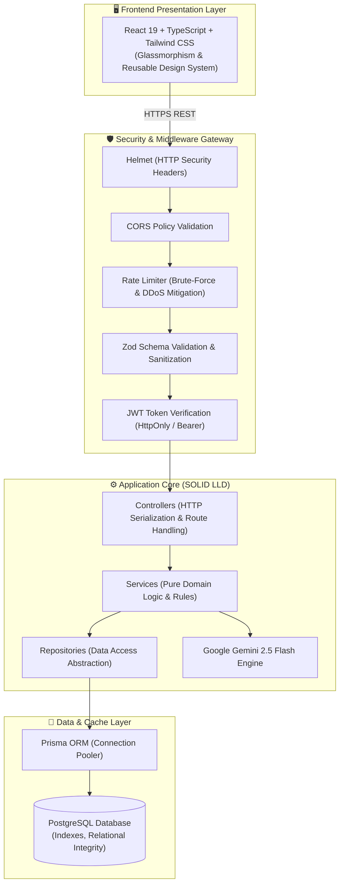

# 🚀 Catalyst AI - Enterprise Scalable Architecture

[](https://hack2skill.com)
[](https://developers.google.com)
[](https://en.wikipedia.org/wiki/SOLID)
[](https://prisma.io)

---

## 📌 Executive Summary

An enterprise-grade, high-performance web platform built for the **Catalyst Hackathon 2026** (Google for Developers & Hack2Skill). 

The platform is designed with an uncompromising focus on:
1. **Low-Level Design (LLD) & SOLID Principles** (Decoupled Controller-Service-Repository pattern).
2. **Enterprise Defense-in-Depth Security** (Rate limiting, Zod schema validation, Helmet, HttpOnly cookie authentication).
3. **High Scalability & Performance** (PostgreSQL with indexed queries, Prisma ORM connection pooling, stateless REST APIs).
4. **Google Gemini Intelligence** (Resilient LLM strategy pattern with automated fallback & structured output).

---

## 🏛️ High-Level Design (HLD)



---

## 🧩 Low-Level Design (LLD) & SOLID Principles Proof

Our repository architecture strictly implements each of the **5 SOLID Principles**:

| Principle | Architectural Implementation | Verification Path |
| :--- | :--- | :--- |
| **S - Single Responsibility** | Strict separation: Controllers only serialize HTTP, Services execute domain logic, Repositories handle database persistence. | `server/src/modules/auth/` |
| **O - Open / Closed** | Strategy pattern applied to external services. The `IAiService` interface allows plugging in new AI providers without altering business rules. | `server/src/services/ai/ai.interface.ts` |
| **L - Liskov Substitution** | Interface-driven services ensure mock implementations or alternative database adapters can substitute production classes seamlessly. | `server/src/services/ai/gemini.service.ts` |
| **I - Interface Segregation** | Fine-grained, focused interfaces (`IAuthRepository`, `IAuthService`) prevent consumers from depending on unused methods. | `server/src/modules/auth/auth.repository.ts` |
| **D - Dependency Inversion** | High-level controllers depend on service abstractions; services depend on repository abstractions, injected via constructors. | `server/src/modules/auth/auth.routes.ts` |

---

## 📂 Repository File Structure

```text
├── client/                     # Frontend Application (React + Vite + Tailwind)
│   ├── src/
│   │   ├── components/         # Reusable UI primitives (Navbar, StatCard, AuthModal)
│   │   ├── context/            # Global state (AuthContext with session sync)
│   │   ├── services/           # ApiClient fetch wrapper
│   │   ├── types/              # TypeScript models & response contracts
│   │   ├── App.tsx             # Main Dashboard & Interactive Sandbox
│   │   └── main.tsx            # React DOM mounting
│   ├── package.json
│   └── vite.config.ts          # Reverse proxy configuration to backend
│
├── server/                     # Backend API (Node.js + Express + TypeScript)
│   ├── prisma/
│   │   └── schema.prisma       # Relational Schema with indexes & constraints
│   ├── src/
│   │   ├── config/             # Environment parsing (Zod) & Prisma Singleton
│   │   ├── middlewares/        # Security, Auth, Validation, Rate Limiter, Error Handler
│   │   ├── modules/
│   │   │   ├── auth/           # Controller, Service, Repository, Schema, Routes
│   │   │   └── health/         # System latency & memory diagnostic routes
│   │   ├── services/           # Gemini AI integration layer (Strategy Pattern)
│   │   ├── utils/              # Standard ApiResponse, ApiError, Structured Logger
│   │   ├── app.ts              # Express application assembly
│   │   └── index.ts            # Server entrypoint with graceful shutdown
│   ├── package.json
│   └── tsconfig.json
│
├── .gitignore
├── package.json                # Monorepo orchestration scripts
└── README.md                   # System Architecture & Documentation
```

---

## 🛡️ Enterprise Security Model

1. **Input Sanitization & Schema Validation:** Every request body, query, and parameter is verified against strict Zod schemas before reaching controllers.
2. **Cookie-Based HttpOnly JWT Authentication:** Avoids client-side XSS token theft.
3. **Multi-tier Rate Limiting:**
   * Global routes: 100 reqs / 15 mins.
   * Sensitive auth & AI endpoints: 20 reqs / 15 mins.
4. **Hardened HTTP Headers:** Powered by `helmet` with strict CSP and frameguard policies.
5. **Centralized Error Handling:** Prevents stack trace leakage in production environments.

---

## 🚀 Quick Start Guide

### Prerequisites
* Node.js v18+ (tested on v24)
* PostgreSQL Database (Local instance or free cloud DB on [Neon.tech](https://neon.tech) / [Supabase](https://supabase.com))

### 1. Setup Backend
```bash
cd server
npm install
cp .env.example .env
# Update DATABASE_URL and GEMINI_API_KEY in .env

# Generate Prisma Client & Run Migrations
npx prisma generate
npx prisma db push

# Start Backend Server
npm run dev
```

### 2. Setup Frontend
```bash
cd client
npm install
npm run dev
```

Frontend runs at: `http://localhost:5173`  
Backend runs at: `http://localhost:5000`

---

## 🌐 Live Deployment Strategy

* **Frontend:** One-click deployment on **Vercel** (`client` root directory).
* **Backend:** Deployed on **Render** or **Railway** (`server` root directory).
* **Database:** Managed serverless PostgreSQL on **Neon.tech** or **Supabase**.

---

<div align="center">
  <b>Catalyst Hackathon 2026</b> • Crafted with Precision & Clean Code
</div>
