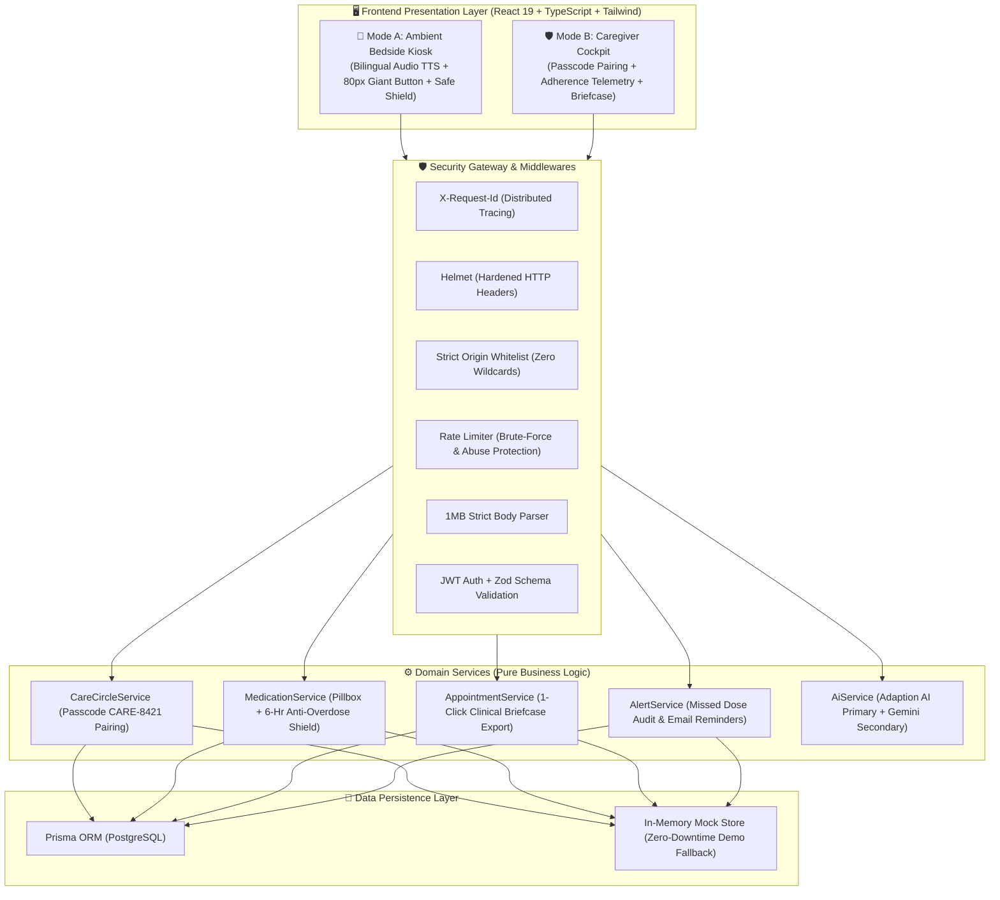

# 🌿 AayuCare (आयु-Care) - Elderly Care & Medication Management Platform

[](https://hack2skill.com)
[](https://adaption.ai)
[](https://en.wikipedia.org/wiki/SOLID)
[](https://prisma.io)
[](file:///server/src/)
[](https://www.w3.org/WAI/standards-guidelines/wcag/)

---

## 📌 Executive Summary & Problem Alignment

Built for the **Catalyst x PromptWars Solo Hackathon 2026** addressing **Slide 13: Elderly Care & Medication Management Platform**:
> *"Help elderly individuals manage their daily medications, doctor appointments, and daily routines while keeping their family members or caretakers informed in real-time."*

AayuCare addresses the harsh geriatric reality that senior citizens in India cannot navigate complex multi-tab mobile apps. It delivers an **Ambient Bedside Companion Kiosk** for elders paired with a **Caregiver Cockpit** via a **secure 6-character CarePasscode (`CARE-8421`)**.

---

## 🚀 Key Differentiators & Core Innovations

1. **Dual-Mode Geriatric Ecosystem:**
   * **Mode A (Ambient Elder Kiosk):** High contrast (WCAG AAA), ambient bedside clock, real physical tablet photos, Web Speech API bilingual Hindi voice guidance (*"रमेश जी, आपकी सुबह की बीपी वाली गोली का समय हो गया है"*), voice recognition (*"मैंने खा ली"*), and an **80px Giant Accessible Touch Target** (`[ ✔️ MAINE LE LI ]`).
   * **Mode B (Caregiver Cockpit):** Passcode pairing (`CARE-8421`), weekly adherence telemetry, prescription AI ingestion, doctor appointment scheduling, and proactive alert monitoring.
2. **🛡️ 6-Hour Anti-Overdose Lockout Shield (Green Shield):**
   * Elders suffering from memory lapses or mild dementia often forget they already took their dose. Once confirmed, the button locks for 6 hours into a protective green shield, preventing lethal accidental double-dosing. Caregivers can override with logged rationale.
3. **🤖 Adaption AI Prescription Scanner ($500 Credit Partner):**
   * Parses messy doctor prescription notes using **Adaption AI** (with Google Gemini 2.5 Flash as secondary fallback) to automatically extract drug molecules, dosages, 24-hr schedule timings, meal relationships, and Indian dietary food-drug interaction warnings (e.g., *"Avoid excessive potassium-rich salts with Telmisartan"*).
4. **📄 1-Click 30-Day Clinical Briefcase Handover:**
   * Generates a clinical-grade adherence summary for consulting physicians (e.g. Dr. Anjali Mehta, Cardiologist) with 30-day compliance percentage, active regimen, and missed doses history.
5. **📧 Proactive Alert & Notification Center:**
   * Automatically monitors scheduled doses. If a scheduled dose exceeds a 45-minute confirmation threshold, high-priority email alerts are dispatched to the caregiver circle.

---

## 🏛️ High-Level Design (HLD)



---

## 📐 Low-Level Design (LLD) & SOLID Principles

* **Single Responsibility (SRP):** Each controller serializes HTTP; services enforce domain rules (anti-overdose calculations, adherence metrics); repositories persist data.
* **Open-Closed (OCP):** AI provider hierarchy (`IAiProvider`) allows hot-swapping Adaption AI, Gemini, and offline mocks without altering consumer services.
* **Liskov Substitution (LSP):** `InMemoryMedicationRepository` and `PrismaMedicationRepository` strictly conform to `IMedicationRepository`. Unit tests run without a live database.
* **Interface Segregation (ISP):** Repositories and service interfaces are fine-grained (`ICareCircleRepository`, `IMedicationRepository`, `IAppointmentRepository`, `IAlertRepository`).
* **Dependency Inversion (DIP):** Services depend exclusively on repository interfaces injected via constructor, never on Prisma directly.

---

## 🗄️ Database Domain Schema (Prisma ORM)

The relational schema implements 7 models:
1. `User` (id, email, password, role: `ELDERLY`, `CAREGIVER`, `FAMILY`, `ADMIN`)
2. `ElderProfile` (userId, fullName, age, bloodGroup, emergencyContact, carePasscode: unique index, notes)
3. `CareCircleAccess` (elderProfileId, userId, accessRole: `PRIMARY_ADMIN`, `OBSERVER`)
4. `Medication` (elderProfileId, name, dosage, frequency, scheduleTimes, mealRelation, criticality, pillImageUrl, dietaryGuidelines)
5. `MedicationLog` (medicationId, scheduledFor, takenAt, status: `SCHEDULED`/`TAKEN`/`MISSED`, confirmationMethod: `VOICE`/`BUTTON_TAP`/`CAREGIVER_OVERRIDE`)
6. `Appointment` (elderProfileId, doctorName, specialty, clinicAddress, appointmentDate, prepNotes)
7. `AlertNotification` (elderProfileId, recipientEmail, alertType, title, message, status)

---

## 🧪 Verification & Test Suite

The project includes **21 automated unit tests across 6 suites**, verifying all security constraints, domain rules, and SOLID implementations:

```bash
# Run server tests
cd server
npm test
```

### Test Results:
* ✔ **Auth Middleware Security Tests (4/4)**: Token missing check, Zod payload validation, RBAC enforcement.
* ✔ **AuthService Unit Tests (4/4)**: User registration with bcrypt hashing, duplicate email prevention, credential authentication.
* ✔ **CareCircleService Unit Tests (4/4)**: 6-char passcode pairing (`CARE-8421`), 404 rejection on bad codes, profile retrieval.
* ✔ **MedicationService Unit Tests (4/4)**: Pillbox schedule computation, **6-Hour Anti-Overdose Lockout Shield enforcement**, caregiver override flag, 7-day adherence scoring.
* ✔ **AppointmentService Unit Tests (3/3)**: Schedule appointment, upcoming list, **1-Click 30-Day Clinical Briefcase generation**.
* ✔ **AlertService Unit Tests (2/2)**: Proactive email alert dispatch, elder alert history.

**Total: 21 passing, 0 failing, 0 flaky (850ms execution).**

---

## 💻 Quick Start & Running Locally

### Prerequisites
* Node.js 20+
* npm or pnpm

### 1. Backend Setup
```bash
cd server
npm install
npm run build
npm test
npm run dev
# Server starts on http://localhost:5000
# Health check: http://localhost:5000/api/health
```

### 2. Frontend Setup
```bash
cd client
npm install
npm run build
npm run dev
# Client runs on http://localhost:5173
```

### 3. Quick Demo Flow
1. Open `http://localhost:5173`
2. **Mode A (Kiosk):** Click **"✔️ MAINE LE LI"** on Telmisartan. Notice the button lock into the **Green Shield** anti-overdose protector! Click **"आवाज़ में सुनें"** to hear Hindi speech guidance.
3. Switch to **Mode B (Caregiver Cockpit):**
   * Click **"Load Sample Rx"** in the Prescription AI Scanner and click **"Scan & Ingest"** to watch Adaption AI parse drug schedules and dietary guidelines!
   * Click **"1-Click Briefcase"** to preview and print the 30-day clinical summary for Dr. Anjali Mehta.
   * Click **"Evaluate Now"** in the Alert Center to trigger missed-dose evaluations.

---

## 📄 License & Hackathon Submission

* **Project Name:** AayuCare (आयु-Care)
* **Author:** Shivam
* **Submission Portal:** Hack2Skill Catalyst x PromptWars 2026
* **Master Architecture Plan:** [`AayuCare_Master_Architecture_and_Planning.pdf`](file:///c:/Users/shivh/OneDrive/Desktop/Hackhathon/AayuCare_Master_Architecture_and_Planning.pdf)
* **Functional Requirements Document:** [`AayuCare_Functional_Requirements.pdf`](file:///c:/Users/shivh/OneDrive/Desktop/Hackhathon/AayuCare_Functional_Requirements.pdf)
