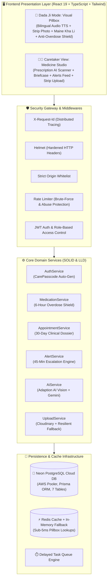

# 🌿 AayuCare (आयु-Care) - Elderly Care & Medication Management Platform

[](https://hack2skill.com)
[](https://adaption.ai)
[](https://en.wikipedia.org/wiki/SOLID)
[](https://neon.tech)
[](#-automated-tests--verification)
[](https://practo.com)

---

## 📌 Executive Summary & Problem Alignment

Built for the **Catalyst x PromptWars Solo Hackathon 2026** addressing **Slide 13: Elderly Care & Medication Management Platform**:
> *"Help elderly individuals manage their daily medications, doctor appointments, and daily routines while keeping their family members or caretakers informed in real-time."*

AayuCare addresses the harsh geriatric reality that senior citizens in India cannot navigate complex multi-tab mobile apps with tiny text or dark cluttered themes. It delivers a clean, high-readability **Elderly Visual Pillbox** with actual tablet strip photos and caretaker voice guidance, paired with an executive **Caregiver Studio** connected via a **secure 6-character CarePasscode (`CARE-8421`)**.

---

## 🚀 Key Differentiators & Core Innovations

1. **Dual-Mode Geriatric Ecosystem with Instant Localization:**
   * **👴 Dada Ji View (Visual Pillbox):** Clean Practo/Apollo clinical aesthetic (`#0D9488` medical teal), categorized into 4 day-slots (Morning, Afternoon, Evening, Night). Real physical tablet strip photos uploaded by caregiver, loving voice note playback (*"दादा जी, नाश्ते के 15 मिनट बाद 1 गोली गुनगुने पानी के साथ ले लीजिए"*), Web Audio synthesized chimes (C5-E5-G5), and a prominent **"मैंने खा ली ✅"** button.
   * **👩‍⚕️ Caretaker View:** 6-character CarePasscode pairing (`CARE-8421`), 30-day adherence monitoring (94%), appointment management, and proactive alert escalations.
   * **🇮🇳 Instant Language Switcher (`[🇮🇳 हिंदी | English]`):** 1-click toggle in the navbar to switch the entire application between pure Hindi and clean English.

2. **🛡️ 6-Hour Anti-Overdose Lockout Shield:**
   * Senior citizens with cognitive decline or mild dementia often forget they already took their dose. Once confirmed, the system enforces a 6-hour lockout with gentle reassuring safety guidance (*"सुरक्षा लॉक: दादा जी, आप यह गोली ले चुके हैं। कृपया दोबारा न लें"*), preventing fatal double dosing.

3. **🚨 45-Minute Missed-Dose Escalation Engine:**
   * Automated background queue evaluator scans scheduled doses. If a high-risk medication exceeds a 45-minute confirmation threshold, high-priority alert escalations are dispatched to family members with a 1-tap **"Call Dada Ji"** direct dialer.

4. **🤖 Adaption AI Multimodal Prescription Scanner ($500 Partner Credit):**
   * Uses **Adaption AI Vision & LLM** (with Google Gemini 2.5 Flash fallback) to scan doctor prescription slips (Rx), auto-extracting drug names, dosages, 24-hr schedule timings, and Indian dietary food-drug interaction warnings (e.g., *"खट्टे फल और मौसमी का जूस साथ में न लें"* with BP medication Telmisartan).
   * **1-Click Auto-Fill:** Instantly populates the Add Medication form from AI-extracted prescriptions!

5. **📋 1-Click 30-Day Clinical Briefcase for Doctor Visits:**
   * Generates a clinical-grade adherence dossier for consulting physicians (e.g. Dr. Arvind Sharma, Senior Cardiologist at Max Hospital) with 30-day compliance percentage, active regimen audit, and AI Doctor executive notes ready for Print/PDF.

---

## 🏛️ High-Level Design (HLD)



---

## 🧪 Automated Tests & Verification

The backend includes **47 automated unit tests across 10 suites**, verifying all domain rules, safety constraints, and SOLID architecture:

```bash
cd server
npm test
```

### Test Results Breakdown:
* ✔ **CacheService Unit Tests (2/2)**: Cache hit/miss fidelity and prefix purge.
* ✔ **QueueService Unit Tests (2/2)**: Delayed escalation timer and cancellation.
* ✔ **Auth Middleware Security Tests (4/4)**: Token verification, Zod payload validation, RBAC enforcement.
* ✔ **AiService Multimodal Tests (4/4)**: Prescription OCR extraction, Indian dietary interaction warnings, pill OCR verification.
* ✔ **AlertService & Escalation Engine (5/5)**: 45-minute missed-dose escalation scan, unread feed counter, acknowledgment resolution.
* ✔ **AppointmentService & Briefcase (7/7)**: Scheduling with fasting notes, 30-day clinical briefcase dossier generation.
* ✔ **AuthService Unit Tests (7/7)**: Registration with bcrypt hashing, CarePasscode generation, Google OAuth 2.0 provisioning.
* ✔ **CareCircleService Unit Tests (7/7)**: 6-char passcode pairing (`CARE-8421`), self-pairing prevention, profile updates.
* ✔ **MedicationService Unit Tests (7/7)**: Visual Pillbox slot bucketing, "Maine Kha Li" confirmation, **6-Hour Anti-Overdose Lockout Shield enforcement**, 7-day adherence scoring.
* ✔ **UploadService Tests (2/2)**: Tablet strip photo buffer upload, voice note audio buffer upload with offline fallback.

**Total: 47 passed, 0 failed, 10 suites green (1.3s execution).**

---

## 🔑 Pre-Seeded Evaluator Demo Accounts

The live Neon PostgreSQL cloud database has been pre-seeded with test data for judges:

| Role | Email | Password | Details |
|---|---|---|---|
| **👴 Dada Ji (Elder)** | `dadaji.demo@aayucare.in` | `Password@123` | CarePasscode: **`CARE-8421`**, active BP & Sugar regimens |
| **👩‍⚕️ Caregiver (Son)** | `rohit.caregiver@aayucare.in` | `Password@123` | Paired with Dada Ji in Care Circle |

*Note: You can also use the **1-Click Demo Buttons** inside the Sign In modal to test without typing!*

---

## 💻 Quick Start & Running Locally

### Prerequisites
* Node.js 20+
* npm or pnpm

### 1. Backend Setup
```bash
cd server
npm install
npm run build
npm test
npm run dev
# Backend starts on http://localhost:5000
# Health check: http://localhost:5000/api/health
```

### 2. Frontend Setup
```bash
cd client
npm install
npm run build
npm run dev
# Frontend starts on http://localhost:5173
```

---

## 📄 License & Hackathon Credits

* **Platform Name:** AayuCare (आयु-Care)
* **Author:** Shivam
* **Event:** Catalyst x PromptWars Solo Hackathon 2026 (Google for Developers & Hack2Skill)
* **Partners:** Adaption AI & MnM
* **GitHub Repository:** [https://github.com/harshshivharedev/AayuCare](https://github.com/harshshivharedev/AayuCare)
