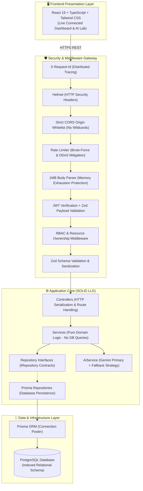

# 🚀 Catalyst AI - Enterprise Scalable Architecture

[](https://hack2skill.com)
[](https://developers.google.com)
[](https://en.wikipedia.org/wiki/SOLID)
[](https://prisma.io)
[](file:///server/src/modules/project/project.service.test.ts)

---

## 📌 Verified Implementation Highlights

An enterprise-grade, high-performance web platform built for the **Catalyst Hackathon 2026** (Google for Developers & Hack2Skill).

Every claim in this documentation is backed by concrete code in the repository:
1. **Controller Layer:** Pure HTTP transport serialization, input validation, and response mapping. Zero business logic.
2. **Service Layer:** Pure business logic. Depends strictly on repository contracts (`IRepository`), zero direct Prisma queries.
3. **Repository Layer:** Pure database persistence abstraction. Zero HTTP or UI logic.
4. **Resilient AI Strategy Pattern:** Google Gemini 2.5 Flash (`GeminiAiProvider`) with 8-second timeout, structured output, and zero-downtime mock fallback (`MockAiProvider`).
5. **Real Live Endpoints:** Frontend is wired directly to backend APIs (`/api/ai/analyze`, `/api/health`, `/api/auth`).
6. **Hardened Security:**
   * **CORS Whitelist:** Strict origin verification (`ENV.CLIENT_URL` + localhost in dev only). Zero wildcards.
   * **Cookie-Only Authentication:** JWT tokens are stored exclusively in `HttpOnly`, `SameSite=Strict` cookies. Tokens are **never leaked** in JSON response bodies.
   * **JWT Runtime Schema Validation:** Decoded JWT payloads are parsed and validated with Zod before attaching to `req.user`.
   * **1MB Body Limit:** Strict payload capacity against memory exhaustion.
   * **Distributed Tracing:** `X-Request-Id` generated and propagated across all logs and response headers.
   * **Prisma Error Code Mapping:** Native translation of `P2002` (409 Conflict), `P2025` (404 Not Found), `P2003` (400 Bad Request).
   * **RBAC & Ownership Security:** Reusable `requireRole` and `requireOwnership` middlewares.

---

## 🏛️ High-Level Design (HLD)



---

## 🧩 Low-Level Design (LLD) & SOLID Proof

| Principle | Architectural Implementation | Code Proof |
| :--- | :--- | :--- |
| **S - Single Responsibility** | Strict layer separation: Controllers only handle HTTP responses; Services execute pure business logic; Repositories isolate Prisma queries. | [`project.controller.ts`](file:///server/src/modules/project/project.controller.ts), [`project.service.ts`](file:///server/src/modules/project/project.service.ts), [`project.repository.ts`](file:///server/src/modules/project/project.repository.ts) |
| **O - Open / Closed** | Strategy pattern applied via `IAiProvider`. New providers (OpenAI, Anthropic, or local LLMs) can be added without modifying `AiService` business logic. | [`ai.interface.ts`](file:///server/src/services/ai/ai.interface.ts), [`gemini.provider.ts`](file:///server/src/services/ai/gemini.provider.ts), [`mock.provider.ts`](file:///server/src/services/ai/mock.provider.ts) |
| **L - Liskov Substitution** | `InMemoryMockProjectRepository` & `InMemoryMockAuthRepository` cleanly substitute Prisma repositories in unit tests with zero changes to services. | [`project.service.test.ts`](file:///server/src/modules/project/project.service.test.ts), [`auth.service.test.ts`](file:///server/src/modules/auth/auth.service.test.ts) |
| **I - Interface Segregation** | Fine-grained contracts (`IProjectRepository`, `IAuthRepository`, `IAiProvider`) prevent forcing classes to implement unused methods. | [`project.repository.ts`](file:///server/src/modules/project/project.repository.ts), [`auth.repository.ts`](file:///server/src/modules/auth/auth.repository.ts) |
| **D - Dependency Inversion** | High-level `ProjectController` depends on `IProjectService`; `ProjectService` depends on `IProjectRepository`, injected via constructors. | [`project.routes.ts`](file:///server/src/modules/project/project.routes.ts), [`auth.routes.ts`](file:///server/src/modules/auth/auth.routes.ts) |

---

## 🔌 API Endpoints Summary

### System & Health
* `GET /api/health/live` - Process liveness check
* `GET /api/health/ready` - Infrastructure readiness check (PostgreSQL ping)
* `GET /api/health` - Full diagnostic summary

### Authentication & Identity
* `POST /api/auth/register` - Create account (Zod validated, password hashed, cookie set, token NEVER in JSON)
* `POST /api/auth/login` - Authenticate & set HttpOnly JWT cookie (token NEVER in JSON)
* `POST /api/auth/logout` - Clear session cookie
* `GET /api/auth/me` - Retrieve current authenticated profile

### Core Domain (Projects & Entities)
* `GET /api/projects` - Paginated & filtered list (`?page=1&limit=10&status=...&search=...`)
* `GET /api/projects/:id` - Fetch single entity by ID
* `POST /api/projects` - Create entity (auto-bound to authenticated user)
* `PATCH /api/projects/:id` - Update entity (enforces resource ownership)
* `DELETE /api/projects/:id` - Delete entity (enforces resource ownership)

### AI Intelligence (Gemini + Fallback)
* `POST /api/ai/analyze` - Execute structured JSON AI analysis with schema validation
* `POST /api/ai/generate` - Execute text generation with prompt & system instructions
* `POST /api/projects/:id/analyze` - Trigger AI analysis on project metadata

---

## 🧪 Unit Tests (11/11 Passing)

```bash
cd server
npm test
```

Test coverage includes:
* **Auth Service:** Registration, password hashing verification, duplicate email rejection, valid login, invalid password rejection.
* **Auth Middleware:** Missing token rejection, valid JWT authentication, malformed/tampered JWT payload Zod rejection, RBAC permission enforcement.
* **Project Service & LLD:** Creation via repository interface (DIP), pagination calculation, AI workflow execution.

---

## 🚀 Quick Start Guide

### 1. Backend Setup
```bash
cd server
npm install
npx prisma generate
npm run dev
```

### 2. Frontend Setup
```bash
cd client
npm install
npm run dev
```

Frontend: `http://localhost:5173`  
Backend: `http://localhost:5000`
