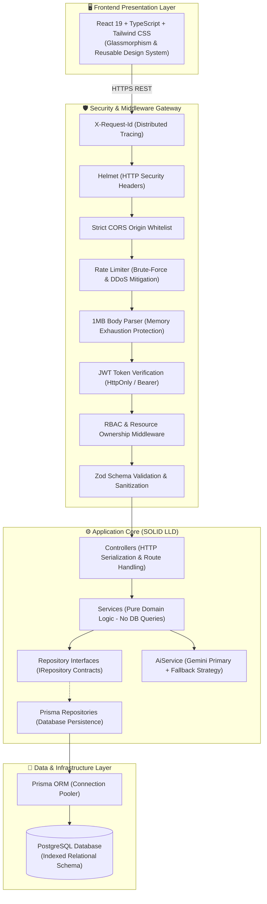

# 🚀 Catalyst AI - Enterprise Scalable Architecture

[](https://hack2skill.com)
[](https://developers.google.com)
[](https://en.wikipedia.org/wiki/SOLID)
[](https://prisma.io)
[](file:///server/src/modules/project/project.service.test.ts)

---

## 📌 Executive Summary

An enterprise-grade, high-performance web platform built for the **Catalyst Hackathon 2026** (Google for Developers & Hack2Skill). 

The platform is engineered according to strict architectural guidelines:
1. **Controller Layer:** Pure HTTP transport serialization, input validation, and response mapping. Zero business logic.
2. **Service Layer:** Pure business validation and logic orchestration. Depends strictly on repository contracts (`IRepository`), zero direct Prisma queries.
3. **Repository Layer:** Pure database persistence abstraction. Zero HTTP or UI logic.
4. **Resilient AI Strategy Pattern:** Google Gemini 2.5 Flash with automated fallback, timeout handling, and structured JSON output.
5. **Defense-in-Depth Security:** Origin whitelist CORS, 1MB body limit, rate-limiting, HttpOnly JWT cookies, RBAC, and resource ownership checks.

---

## 🏛️ High-Level Design (HLD)



---

## 🧩 Low-Level Design (LLD) & SOLID Verification

| Principle | Architectural Implementation | Code Proof |
| :--- | :--- | :--- |
| **S - Single Responsibility** | Strict layer separation: Controllers only handle HTTP responses; Services execute pure business logic; Repositories isolate Prisma queries. | [`project.controller.ts`](file:///server/src/modules/project/project.controller.ts), [`project.service.ts`](file:///server/src/modules/project/project.service.ts), [`project.repository.ts`](file:///server/src/modules/project/project.repository.ts) |
| **O - Open / Closed** | Strategy pattern applied via `IAiProvider`. New providers (OpenAI, Anthropic, or local LLMs) can be added without modifying `AiService` business logic. | [`ai.interface.ts`](file:///server/src/services/ai/ai.interface.ts), [`gemini.provider.ts`](file:///server/src/services/ai/gemini.provider.ts), [`mock.provider.ts`](file:///server/src/services/ai/mock.provider.ts) |
| **L - Liskov Substitution** | `InMemoryMockProjectRepository` cleanly substitutes `PrismaProjectRepository` in unit tests with zero changes to `ProjectService`. | [`project.service.test.ts`](file:///server/src/modules/project/project.service.test.ts) |
| **I - Interface Segregation** | Fine-grained contracts (`IProjectRepository`, `IProjectService`, `IAiProvider`) prevent forcing classes to implement unused methods. | [`project.repository.ts`](file:///server/src/modules/project/project.repository.ts) |
| **D - Dependency Inversion** | High-level `ProjectController` depends on `IProjectService`; `ProjectService` depends on `IProjectRepository`, injected via constructors. | [`project.routes.ts`](file:///server/src/modules/project/project.routes.ts) |

---

## 🛡️ Production Hardening Checklist

- [x] **Strict CORS Whitelist:** Allowed origins: `CLIENT_URL` + localhost in development only.
- [x] **Strict Body Limit:** 1MB limit for JSON and URL-encoded bodies against memory exhaustion attacks.
- [x] **Distributed Tracing:** Automated `X-Request-Id` generation and propagation.
- [x] **Structured Logging:** Structured JSON logs containing timestamps, log level, request IDs, and context.
- [x] **Prisma Error Mapping:** Centralized mapping of Prisma error codes (`P2002` -> 409 Conflict, `P2025` -> 404 Not Found, `P2003` -> 400 Bad Request).
- [x] **RBAC & Ownership Security:** Reusable `requireRole` and `requireOwnership` middlewares.
- [x] **Liveness & Readiness Health Checks:** Separate `/api/health/live` and `/api/health/ready` endpoints.
- [x] **Automated Unit Tests:** Full test suite verifying repository substitution and domain logic.

---

## 🔌 API Endpoints Summary

### System & Health
* `GET /api/health/live` - Process liveness check
* `GET /api/health/ready` - Infrastructure readiness check (PostgreSQL ping)
* `GET /api/health` - Full diagnostic summary

### Authentication & Identity
* `POST /api/auth/register` - Create account (Zod validated, hashed with bcrypt)
* `POST /api/auth/login` - Authenticate & set HttpOnly JWT cookie
* `POST /api/auth/logout` - Clear session cookie
* `GET /api/auth/me` - Retrieve current authenticated profile

### Core Domain (Projects & AI Insights)
* `GET /api/projects` - Paginated & filtered list (`?page=1&limit=10&status=...&search=...`)
* `GET /api/projects/:id` - Fetch single entity by ID
* `POST /api/projects` - Create entity (auto-bound to authenticated user)
* `PATCH /api/projects/:id` - Update entity (enforces resource ownership)
* `DELETE /api/projects/:id` - Delete entity (enforces resource ownership)
* `POST /api/projects/:id/analyze` - Trigger Google Gemini intelligence workflow

---

## 🧪 Running Unit Tests

```bash
cd server
npm test
```

---

## 🚀 Quick Start Guide

### 1. Backend Setup
```bash
cd server
npm install
npx prisma generate
npm run dev
```

### 2. Frontend Setup
```bash
cd client
npm install
npm run dev
```

Frontend: `http://localhost:5173`  
Backend: `http://localhost:5000`
